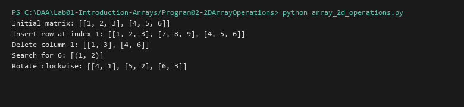

# 2D Array Operations

**Language:** Python 3.10+  
**Run:** `python Lab01-Introduction-Arrays/Program02-2DArrayOperations/array_2d_operations.py`

## Problem statement
Implement insertion, deletion, searching, and rotation on two-dimensional arrays.

## Approach
Represent a matrix as a list of row lists. Validate rectangular shape before column-wise operations. Row and column insertion/deletion use zero-based indices; search returns all matching (row, column) coordinates. Rotation is 90 degrees clockwise and supports rectangular matrices.

## Algorithm and pseudocode
```text
ROTATE_CLOCKWISE(M)
  validate that all rows have equal length
  return transpose(reverse_row_order(M))
```

For row insertion, copy the matrix and insert a copy of the new row at the requested index. For column insertion/deletion, process each row at the same column index.

## Dry run
Input: `[[1,2,3],[4,5,6]]`. Reverse row order gives `[[4,5,6],[1,2,3]]`; transpose gives `[[4,1],[5,2],[6,3]]`.

## Complexity
For an r × c matrix:
| Operation | Best | Average | Worst | Auxiliary space |
|---|---:|---:|---:|---:|
| Insert/delete row | O(rc) | O(rc) | O(rc) | O(rc) |
| Insert/delete column | O(rc) | O(rc) | O(rc) | O(rc) |
| Search | O(1) | O(rc) | O(rc) | O(k), for k matches |
| Rotate | O(rc) | O(rc) | O(rc) | O(rc) |

## Sample I/O
```text
Initial matrix: [[1, 2, 3], [4, 5, 6]]
Insert row at index 1: [[1, 2, 3], [7, 8, 9], [4, 5, 6]]
Delete column 1: [[1, 3], [4, 6]]
Search for 6: [(1, 2)]
Rotate clockwise: [[4, 1], [5, 2], [6, 3]]
```

## Real-life application
Spreadsheet-like data, image grids, and board representations.

## Learning outcomes
_To be completed after execution and reflection._

## Tests and screenshots
See `tests/test_unit1.py`. Capture a genuine terminal screenshot after running the program.


## Visual Execution Output

