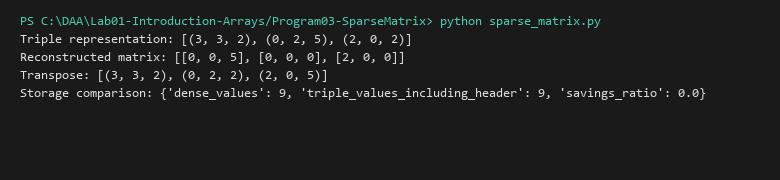

# Sparse Matrix Representation and Operations

**Language:** Python 3.10+  
**Run:** `python Lab01-Introduction-Arrays/Program03-SparseMatrix/sparse_matrix.py`

## Problem statement
Represent a sparse matrix in triple format, reconstruct it, transpose it, add/multiply sparse matrices, and compare storage requirements.

## Approach
Use a header tuple `(rows, columns, nonzero_count)`, followed by zero-based `(row, column, value)` entries sorted in row-major order. Zero values are omitted. Conversion validates dimensions, entry count, coordinates, and duplicate entries.

## Algorithm and pseudocode
```text
TO_TRIPLES(M)
  entries = all (row, column, value) where value is not zero
  return (row_count, column_count, entry_count) followed by entries
```
Addition accumulates values by coordinate and removes entries that cancel to zero. Transpose swaps each coordinate and sorts the result. Multiplication joins nonzero entries on their matching inner index.

## Dry run
Input matrix: `[[0, 5], [2, 0]]`.  
Triple form: `[(2, 2, 2), (0, 1, 5), (1, 0, 2)]`.

## Complexity
Let r×c be the matrix size, z the nonzero count, and zA/zB the nonzero counts of operands.
| Operation | Time | Auxiliary space |
|---|---:|---:|
| Dense → triples | O(rc) | O(z) |
| Triples → dense | O(rc + z) | O(rc) |
| Transpose | O(z log z) | O(z) |
| Addition | O(zA + zB + z log z) | O(z) |
| Multiplication | O(zA × zB + z log z) worst case | O(output nonzeros) |

The multiplication bound is a worst-case upper bound; actual work depends on which inner indices match.

## Sample I/O
```text
Triple representation: [(3, 3, 2), (0, 2, 5), (2, 0, 2)]
Reconstructed matrix: [[0, 0, 5], [0, 0, 0], [2, 0, 0]]
```

## Space analysis
Triple storage uses 3z + 3 scalar values including its header versus rc scalar positions in a dense matrix. For small or dense matrices, triple storage may not save space.

## Real-life application
Sparse graphs, scientific matrices, and systems where most matrix entries are zero.

## Learning outcomes
_To be completed after execution and reflection._

## Tests and screenshots
See `tests/test_unit1.py`. Capture a genuine terminal screenshot after execution.


## Visual Execution Output

