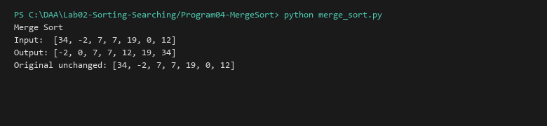

# Merge Sort

**Language:** Python 3.10+  
**Run:** `python Lab02-Sorting-Searching/Program04-MergeSort/merge_sort.py`  
**Shared implementation:** [sorting_algorithms.py](../sorting_algorithms.py)

## Problem statement
Implement Merge Sort as required by Unit 2 and demonstrate it with sample data.

## Approach
The reusable implementation is in `sorting_algorithms.py`. The program in this folder imports and demonstrates the corresponding function. Sorting functions return a new list and do not mutate the source list.

## Algorithm
Divide values into halves, recursively sort each half, then merge the sorted halves.

## Pseudocode
```text
MERGE SORT(A)
  create a working copy of A
  perform the steps described above
  return the sorted working copy
```

## Dry run
[5, 1, 4, 2] → [1, 5] + [2, 4] → [1, 2, 4, 5].

## Complexity analysis
| Case | Time complexity |
|---|---|
| Best | O(n log n) |
| Average | O(n log n) |
| Worst | O(n log n) |

Auxiliary space: **O(n) auxiliary**. The returned list is a separate copy and occupies O(n) memory.

## Sample input/output
```text
Input: [34, -2, 7, 7, 19, 0, 12]
Output: [-2, 0, 7, 7, 12, 19, 34]
```

## Real-life application
Stable; useful for reliable O(n log n) sorting and sequential data processing.

## Learning outcomes
Complete after executing the program and reflecting on the result.

## Tests and screenshots
See [test_unit2.py](../../../tests/test_unit2.py). Capture a real terminal screenshot after running this program.


## Visual Execution Output

