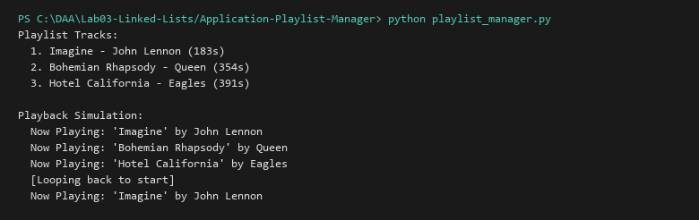

# Playlist Manager (Circular Linked List)

**Language:** Python 3.10+  
**Run:** `python Lab03-Linked-Lists/Application-Playlist-Manager/playlist_manager.py`

## 1. Problem statement
Implement an audio media playlist manager capable of adding tracks, displaying playlist contents, and providing seamless continuous cyclic song navigation (`next_track()`) where advancing past the final track automatically loops back to the start.

## 2. Approach
A Circular Singly Linked List (`SongNode`) models songs as nodes. Each node retains title, artist, duration, and a pointer to the next track. The final node points to the initial head node. The `current_song` cursor traverses the loop in $O(1)$ time per transition without boundary-check branch penalties.

## 3. Algorithm and Pseudocode
```text
NEXT_TRACK(playlist):
  if playlist.current == null: return null
  playlist.current = playlist.current.next
  return playlist.current.info
```

## 4. Complexity analysis
| Operation | Best | Average | Worst | Auxiliary space |
|---|---:|---:|---:|---:|
| Add song | O(1) | O(n) | O(n) | O(1) |
| Next track transition | O(1) | O(1) | O(1) | O(1) |
| List all tracks | O(n) | O(n) | O(n) | O(n) |

## 5. Sample I/O
```text
Playlist Tracks:
  1. Imagine - John Lennon (183s)
  2. Bohemian Rhapsody - Queen (354s)
  3. Hotel California - Eagles (391s)

Playback Simulation:
  Now Playing: 'Imagine' by John Lennon
  Now Playing: 'Bohemian Rhapsody' by Queen
  Now Playing: 'Hotel California' by Eagles
  [Looping back to start]
  Now Playing: 'Imagine' by John Lennon
```

## 6. Real-life application
Music and video streaming services (Spotify, YouTube Music "Repeat All" queue), multimedia carousel presentation displays, and digital advertisement rotation.

## 7. Learning outcomes
- Implemented loop-based continuous iteration through circular linked lists.
- Built clean domain models separating business logic from raw pointer structures.


## Visual Execution Output

