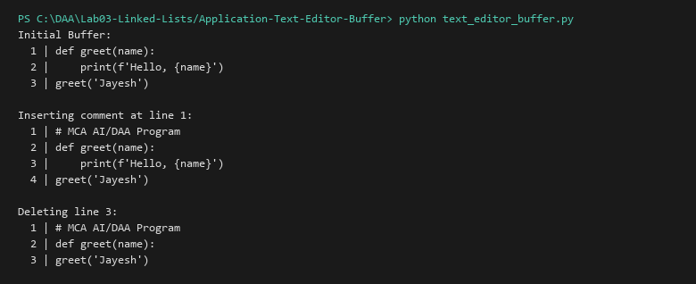

# Text Editor Buffer (Line-by-line editing using Doubly Linked List)

**Language:** Python 3.10+  
**Run:** `python Lab03-Linked-Lists/Application-Text-Editor-Buffer/text_editor_buffer.py`

## 1. Problem statement
Design and implement an in-memory line-by-line text editor buffer where lines can be inserted, edited, and deleted at arbitrary positions efficiently without massive array resizing and copying overhead.

## 2. Approach
Using a Doubly Linked List (`LineNode`), each node stores a single text string line. Inserting or deleting lines in the middle requires only pointer re-wiring ($O(1)$ after locating the line) instead of shifting all subsequent lines in contiguous array memory ($O(n)$ shifts).

## 3. Algorithm and Pseudocode
```text
INSERT_LINE(buffer, line_no, text):
  new_node = LineNode(text)
  curr = buffer.head
  traverse to line_no - 1
  insert new_node between curr and curr.next
  increment line_count
```

## 4. Complexity analysis
| Operation | Best | Average | Worst | Auxiliary space |
|---|---:|---:|---:|---:|
| Insert at line $k$ | O(1) | O(k) | O(n) | O(1) |
| Delete at line $k$ | O(1) | O(k) | O(n) | O(1) |
| Display all lines | O(n) | O(n) | O(n) | O(n) |

## 5. Sample I/O
```text
Initial Buffer:
  1 | def greet(name):
  2 |     print(f'Hello, {name}')
  3 | greet('Jayesh')

Inserting comment at line 1:
  1 | # MCA AI/DAA Program
  2 | def greet(name):
  3 |     print(f'Hello, {name}')
  4 | greet('Jayesh')

Deleting line 3:
  1 | # MCA AI/DAA Program
  2 | def greet(name):
  3 | greet('Jayesh')
```

## 6. Real-life application
Classical line editors such as UNIX `ed`, `nano`, and the internal buffer representations in text editors like Emacs / Vim.

## 7. Learning outcomes
- Implemented real-world text editing buffer data structures using doubly linked lists.
- Avoided large contiguous memory reallocations during frequent document modifications.


## Visual Execution Output

