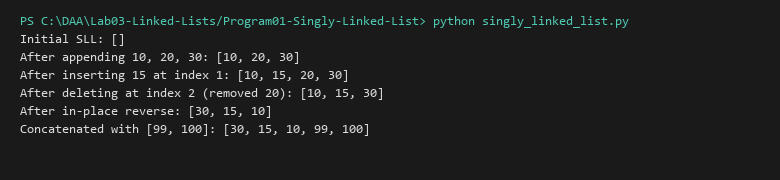

# Singly Linked List

**Language:** Python 3.10+  
**Run:** `python Lab03-Linked-Lists/Program01-Singly-Linked-List/singly_linked_list.py`

## 1. Problem statement
Implement a singly linked list supporting dynamic memory node linking, insertion at arbitrary 0-based positions, deletion at arbitrary positions, in-place reversal, and list concatenation.

## 2. Approach
A node structure contains a `data` field and a pointer/reference `next` to the succeeding node. The `SinglyLinkedList` class maintains the `head` reference and a size counter. Insertion and deletion traverse to the predecessor index $(pos - 1)$ to update pointer references. In-place reversal uses three pointers (`prev`, `curr`, `next_node`) to invert pointers in a single linear pass with $O(1)$ auxiliary memory.

## 3. Algorithm and Pseudocode
```text
REVERSE(head):
  prev = null
  curr = head
  while curr != null:
    next_node = curr.next
    curr.next = prev
    prev = curr
    curr = next_node
  return prev
```

## 4. Dry run
Initial: `[10 -> 20 -> 30]`. Reversal iteration:
1. `curr = 10`, `next = 20`, `10.next = None`, `prev = 10`
2. `curr = 20`, `next = 30`, `20.next = 10`, `prev = 20`
3. `curr = 30`, `next = None`, `30.next = 20`, `prev = 30`
Terminates: `head` updated to `30 -> 20 -> 10`.

## 5. Complexity analysis
| Operation | Best | Average | Worst | Auxiliary space |
|---|---:|---:|---:|---:|
| Insert at head (pos=0) | O(1) | O(1) | O(1) | O(1) |
| Insert at position $k$ | O(1) | O(k) | O(n) | O(1) |
| Delete at head (pos=0) | O(1) | O(1) | O(1) | O(1) |
| Delete at position $k$ | O(1) | O(k) | O(n) | O(1) |
| Reverse | O(n) | O(n) | O(n) | O(1) |
| Concatenate | O(m + n) | O(m + n) | O(m + n) | O(m + n) |

## 6. Sample I/O
```text
Initial SLL: []
After appending 10, 20, 30: [10, 20, 30]
After inserting 15 at index 1: [10, 15, 20, 30]
After deleting at index 2 (removed 20): [10, 15, 30]
After in-place reverse: [30, 15, 10]
Concatenated with [99, 100]: [30, 15, 10, 99, 100]
```

## 7. Real-life application
Underlying implementation for memory allocators (free lists), hash table separate chaining, and undo history buffers.

## 8. Learning outcomes
- Implemented node-based dynamic data structures without fixed capacity constraints.
- Mastered pointer manipulation, edge-case handling (empty list, single element), and in-place list inversion.


## Visual Execution Output

