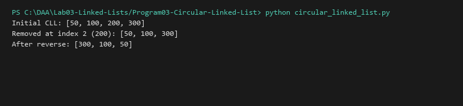

# Circular Linked List

**Language:** Python 3.10+  
**Run:** `python Lab03-Linked-Lists/Program03-Circular-Linked-List/circular_linked_list.py`

## 1. Problem statement
Implement a circular singly linked list where the terminal node points back to the head node. Support dynamic element insertion at positions, deletion, in-place reversal, and list concatenation while preserving the circular invariant.

## 2. Approach
The list maintains a reference to `head` and its size. The terminal node's `next` pointer always references `head`. Deleting or inserting at the head requires locating the circular tail or updating the tail's link. Reversal reverses node arrows while resetting the original head to point cyclically to the new head.

## 3. Algorithm and Pseudocode
```text
INSERT_HEAD_CLL(head, val):
  new_node = Node(val)
  if head == null:
    new_node.next = new_node
    return new_node
  tail = head
  while tail.next != head:
    tail = tail.next
  new_node.next = head
  tail.next = new_node
  return new_node
```

## 4. Complexity analysis
| Operation | Best | Average | Worst | Auxiliary space |
|---|---:|---:|---:|---:|
| Insert at position $k$ | O(1) | O(k) | O(n) | O(1) |
| Delete at position $k$ | O(1) | O(k) | O(n) | O(1) |
| Reverse | O(n) | O(n) | O(n) | O(1) |
| Concatenate | O(m + n) | O(m + n) | O(m + n) | O(m + n) |

## 5. Sample I/O
```text
Initial CLL: [50, 100, 200, 300]
Removed at index 2 (200): [50, 100, 300]
After reverse: [300, 100, 50]
```

## 6. Real-life application
Round-robin CPU process schedulers, media players cycling songs continuously, and multiplayer turn-based game rotations.

## 7. Learning outcomes
- Implemented cyclic pointer data structures without sentinel termination (`null`).
- Managed the cyclic invariant across insertions, deletions, and reversals.


## Visual Execution Output

