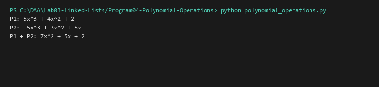

# Polynomial Operations using Linked List

**Language:** Python 3.10+  
**Run:** `python Lab03-Linked-Lists/Program04-Polynomial-Operations/polynomial_operations.py`

## 1. Problem statement
Represent multivariate or univariate polynomials using singly linked lists of non-zero terms sorted in descending order of exponent, and implement an efficient $O(m + n)$ polynomial addition algorithm.

## 2. Approach
Each node stores `(coefficient, exponent, next)`. Terms with identical exponents are combined upon insertion. Polynomial addition employs a two-pointer merge approach similar to Merge Sort's merge step: comparing exponents of current nodes from both polynomials, advancing the pointer with the higher exponent, or combining coefficients when exponents match.

## 3. Algorithm and Pseudocode
```text
ADD_POLYNOMIALS(P1, P2):
  result = empty polynomial
  p1 = P1.head, p2 = P2.head
  while p1 != null and p2 != null:
    if p1.exp > p2.exp:
      result.append(p1.coeff, p1.exp); p1 = p1.next
    else if p1.exp < p2.exp:
      result.append(p2.coeff, p2.exp); p2 = p2.next
    else:
      sum_c = p1.coeff + p2.coeff
      if sum_c != 0: result.append(sum_c, p1.exp)
      p1 = p1.next; p2 = p2.next
  append remaining terms of p1 and p2
  return result
```

## 4. Complexity analysis
| Operation | Best | Average | Worst | Auxiliary space |
|---|---:|---:|---:|---:|
| Insert term | O(1) | O(k) | O(n) | O(1) |
| Polynomial Addition | O(m + n) | O(m + n) | O(m + n) | O(m + n) |

## 5. Sample I/O
```text
P1: 5x^3 + 4x^2 + 2
P2: -5x^3 + 3x^2 + 5x
P1 + P2: 7x^2 + 5x + 2
```

## 6. Real-life application
Computer Algebra Systems (CAS) like SymPy and Mathematica, graphics rendering curve representations, and symbolic calculus evaluation.

## 7. Learning outcomes
- Implemented mathematical structures as ordered dynamic linked chains.
- Applied the two-pointer merge paradigm to symbolic polynomial arithmetic.


## Visual Execution Output

