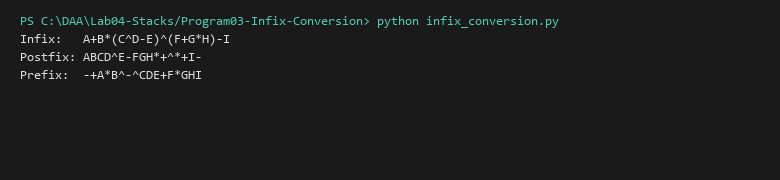

# Infix to Postfix and Prefix Conversion

**Language:** Python 3.10+  
**Run:** `python Lab04-Stacks/Program03-Infix-Conversion/infix_conversion.py`

## 1. Problem statement
Convert standard human-readable infix arithmetic expressions containing operators (`+`, `-`, `*`, `/`, `^`) and parentheses into parenthesisfree Postfix (Reverse Polish) and Prefix (Polish) notations using Dijkstra's Shunting-Yard stack algorithm.

## 2. Approach
An operator stack temporarily holds operators based on precedence hierarchy and associativity rules (`^` is right-associative; others left-associative). Prefix conversion is performed by reversing the infix expression, swapping parentheses, running the modified shunting-yard algorithm, and reversing the resulting output.

## 3. Complexity analysis
| Metric | Infix to Postfix | Infix to Prefix |
|---|---:|---:|
| Time Complexity | O(n) | O(n) |
| Auxiliary Space | O(n) | O(n) |

## 4. Sample I/O
```text
Infix:   A+B*(C^D-E)^(F+G*H)-I
Postfix: ABCD^E-FGH*+^*+I-
Prefix:  -+A*B^-^CDE+F*GHI
```

## 5. Real-life application
Compiler parsing front-ends, AST generation, and stack-based bytecode virtual machines (e.g. JVM, Python disassembler).


## Visual Execution Output

