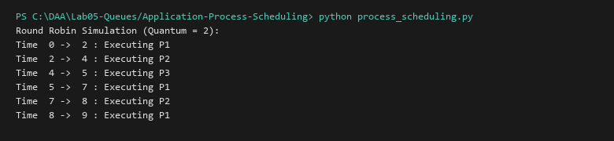

# OS Process Scheduling Simulation

**Language:** Python 3.10+  
**Run:** `python Lab05-Queues/Application-Process-Scheduling/process_scheduling.py`

## 1. Problem statement
Simulate operating system CPU process scheduling using a circular ready-queue discipline (Round-Robin with fixed time quantum $Q$).

## 2. Approach
Active processes enter the tail of the ready queue. The scheduler dequeues the head process, executes it for $\min(Q, \text{remaining\_time})$, updates the global clock, and if incomplete, enqueues it back to the tail until all processes terminate.

## 3. Complexity analysis
| Operation | Time | Auxiliary Space |
|---|---:|---:|
| Round Robin Step | O(1) | O(1) |
| Total Simulation | O(N \times \lceil\text{Burst}/Q\rceil) | O(N) |

## 4. Sample I/O
```text
Round Robin Simulation (Quantum = 2):
Time  0 ->  2 : Executing P1
Time  2 ->  4 : Executing P2
Time  4 ->  5 : Executing P3
Time  5 ->  7 : Executing P1
Time  7 ->  8 : Executing P2
Time  8 ->  9 : Executing P1
```

## 5. Real-life application
Operating system CPU schedulers (Linux Completely Fair Scheduler, Windows thread dispatcher) and network traffic fair queuing.


## Visual Execution Output

