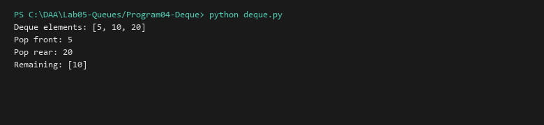

# Double-Ended Queue (Deque)

**Language:** Python 3.10+  
**Run:** `python Lab05-Queues/Program04-Deque/deque.py`

## 1. Problem statement
Implement a dynamic Double-Ended Queue (Deque) supporting $O(1)$ operations at both ends: `append_front`, `append_rear`, `pop_front`, `pop_rear`, `peek_front`, and `peek_rear`.

## 2. Approach
A doubly linked list node structure (`DequeNode`) with bidirectional references maintains both `head` and `tail` sentinels, enabling constant-time insertion and deletion from either end.

## 3. Complexity analysis
| Operation | Best | Average | Worst | Auxiliary Space |
|---|---:|---:|---:|---:|
| Append Front / Rear | O(1) | O(1) | O(1) | O(1) |
| Pop Front / Rear | O(1) | O(1) | O(1) | O(1) |
| Peek Front / Rear | O(1) | O(1) | O(1) | O(1) |

## 4. Sample I/O
```text
Deque elements: [5, 10, 20]
Pop front: 5
Pop rear: 20
Remaining: [10]
```

## 5. Real-life application
Sliding-window maximum algorithms, palindrome verification, work-stealing scheduling algorithms in multi-threaded runtimes.


## Visual Execution Output

