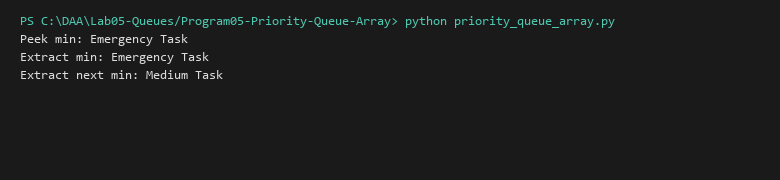

# Priority Queue (Array-Based)

**Language:** Python 3.10+  
**Run:** `python Lab05-Queues/Program05-Priority-Queue-Array/priority_queue_array.py`

## 1. Problem statement
Implement an array-backed Priority Queue prioritizing elements by numeric priority score, analyzing the trade-offs of $O(1)$ unsorted insertion vs $O(n)$ search and extraction.

## 2. Approach
Tuples of `(priority, value)` are appended to an array in constant $O(1)$ time. `extract_min` scans linearly through the array in $O(n)$ time to locate and remove the minimal element.

## 3. Complexity analysis
| Operation | Time Complexity | Auxiliary Space |
|---|---:|---:|
| Insert | O(1) | O(1) |
| Extract-Min | O(n) | O(1) |
| Peek-Min | O(n) | O(1) |

## 4. Sample I/O
```text
Peek min: Emergency Task
Extract min: Emergency Task
Extract next min: Medium Task
```

## 5. Real-life application
Low-throughput event queues with frequent fast insertions and rare batch extractions.


## Visual Execution Output

