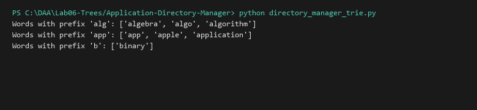

# Directory Manager and Autocomplete Dictionary (Trie Bonus)

**Language:** Python 3.10+  
**Run:** `python Lab06-Trees/Application-Directory-Manager/directory_manager_trie.py`

## 1. Problem statement
Implement an efficient Prefix-Tree (Trie) supporting word insertions, exact word searching, and prefix-based autocomplete queries in $O(L)$ time where $L$ is word length.

## 2. Approach
Each character transitions along a Trie edge. Finding words with prefix $P$ traverses to the prefix terminus node and collects all descendants through Depth-First Search.

## 3. Complexity analysis
| Operation | Time | Auxiliary Space |
|---|---:|---:|
| Insert Word | O(L) | O(L) |
| Search Word | O(L) | O(1) |
| Autocomplete | O(P + K) | O(K) |

## 4. Sample I/O
```text
Words with prefix 'alg': ['algebra', 'algo', 'algorithm']
Words with prefix 'app': ['app', 'apple', 'application']
Words with prefix 'b': ['binary']
```

## 5. Real-life application
Search engine query autocomplete, mobile predictive keyboard dictionaries, and filesystem path auto-suggestion in bash shells.


## Visual Execution Output

