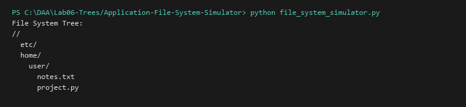

# File System Simulator (Hierarchical Tree Structure)

**Language:** Python 3.10+  
**Run:** `python Lab06-Trees/Application-File-System-Simulator/file_system_simulator.py`

## 1. Problem statement
Model a hierarchical file system where directories and files form an N-ary tree supporting navigation (`cd`, `cd ..`), directory creation (`mkdir`), file creation (`touch`), and recursive tree rendering.

## 2. Approach
`FSNode` represents nodes with `is_dir` flag and a dictionary of named children. Tree traversal recursively displays nested folders and files with indented visual hierarchies.

## 3. Complexity analysis
| Operation | Time | Auxiliary Space |
|---|---:|---:|
| mkdir / touch | O(1) | O(1) |
| cd | O(1) | O(1) |
| Tree view | O(N) | O(depth) |

## 4. Sample I/O
```text
File System Tree:
//
  etc/
  home/
    user/
      notes.txt
      project.py
```

## 5. Real-life application
UNIX VFS (Virtual File System) inode trees, Windows NTFS B-tree directory structures.


## Visual Execution Output

