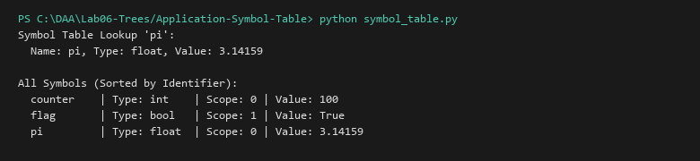

# Symbol Table for a Mini-Compiler using BST

**Language:** Python 3.10+  
**Run:** `python Lab06-Trees/Application-Symbol-Table/symbol_table.py`

## 1. Problem statement
Implement a Symbol Table for a compiler front-end using a Binary Search Tree (BST) to store, update, and resolve variable identifiers, data types, scope levels, and values in logarithmic time.

## 2. Approach
Identifiers are ordered lexicographically in the BST. `lookup` and `insert` execute in $O(\log n)$ average time.

## 3. Complexity analysis
| Operation | Average | Worst | Auxiliary Space |
|---|---:|---:|---:|
| Insert / Update | O(log n) | O(n) | O(h) |
| Lookup | O(log n) | O(n) | O(1) |
| Inorder Dump | O(n) | O(n) | O(n) |

## 4. Sample I/O
```text
Symbol Table Lookup 'pi':
  Name: pi, Type: float, Value: 3.14159

All Symbols (Sorted by Identifier):
  counter    | Type: int    | Scope: 0 | Value: 100
  flag       | Type: bool   | Scope: 1 | Value: True
  pi         | Type: float  | Scope: 0 | Value: 3.14159
```

## 5. Real-life application
Compiler semantic analysis passes (GCC, Clang, Rustc), linters, and IDE language servers.


## Visual Execution Output

