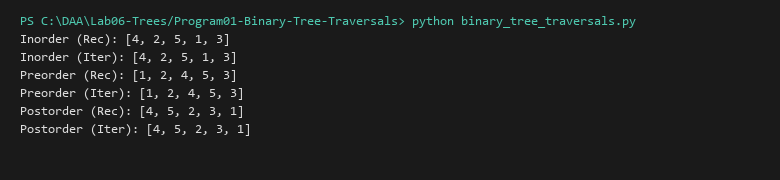

# Binary Tree Traversals (Recursive and Iterative)

**Language:** Python 3.10+  
**Run:** `python Lab06-Trees/Program01-Binary-Tree-Traversals/binary_tree_traversals.py`

## 1. Problem statement
Implement both recursive and explicit stack-based iterative algorithms for standard binary tree depth-first traversals: Inorder ($L-N-R$), Preorder ($N-L-R$), and Postorder ($L-R-N$).

## 2. Approach
Recursive solutions rely on call stack frames. Iterative solutions replace call frames with explicit stack data structures, avoiding recursion depth limit limits on deep trees.

## 3. Complexity analysis
| Traversal | Time Complexity | Auxiliary Space (Call / Explicit Stack) |
|---|---:|---:|
| Inorder (Rec & Iter) | O(n) | O(h) |
| Preorder (Rec & Iter) | O(n) | O(h) |
| Postorder (Rec & Iter) | O(n) | O(h) |

## 4. Sample I/O
```text
Inorder (Rec): [4, 2, 5, 1, 3]
Inorder (Iter): [4, 2, 5, 1, 3]
Preorder (Rec): [1, 2, 4, 5, 3]
Preorder (Iter): [1, 2, 4, 5, 3]
Postorder (Rec): [4, 5, 2, 3, 1]
Postorder (Iter): [4, 5, 2, 3, 1]
```

## 5. Real-life application
Abstract syntax tree (AST) code generators, hierarchical DOM tree rendering, and file hierarchy serialization.


## Visual Execution Output

