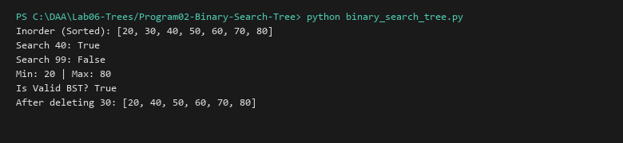

# Binary Search Tree (BST)

**Language:** Python 3.10+  
**Run:** `python Lab06-Trees/Program02-Binary-Search-Tree/binary_search_tree.py`

## 1. Problem statement
Implement a Binary Search Tree (BST) with operations: `insert`, `search`, `delete` (handling 0, 1, and 2 children via inorder successor), `find_min`, `find_max`, and strict BST validity validation.

## 2. Approach
Left subtrees strictly hold keys $< \text{root.key}$; right subtrees hold keys $> \text{root.key}$. Deletion of two-child nodes replaces the key with the in-order successor (minimum element of the right subtree) and recursively deletes that successor.

## 3. Complexity analysis
| Operation | Best / Balanced Average | Worst (Skewed) | Auxiliary Space |
|---|---:|---:|---:|
| Search | O(log n) | O(n) | O(1) iterative |
| Insert | O(log n) | O(n) | O(h) |
| Delete | O(log n) | O(n) | O(h) |
| Validation | O(n) | O(n) | O(h) |

## 4. Sample I/O
```text
Inorder (Sorted): [20, 30, 40, 50, 60, 70, 80]
Search 40: True
Search 99: False
Min: 20 | Max: 80
Is Valid BST? True
After deleting 30: [20, 40, 50, 60, 70, 80]
```

## 5. Real-life application
Database indexing, filesystem path searches, symbol lookup tables.


## Visual Execution Output

