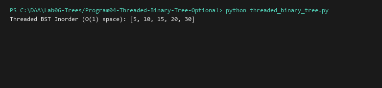

# Threaded Binary Tree (Optional Advanced)

**Language:** Python 3.10+  
**Run:** `python Lab06-Trees/Program04-Threaded-Binary-Tree-Optional/threaded_binary_tree.py`

## 1. Problem statement
Implement a Single-Threaded Binary Search Tree utilizing unused null leaf pointers as "threads" targeting the in-order successor, achieving $O(n)$ in-order traversal in strict $O(1)$ auxiliary space without recursion or stacks.

## 2. Approach
Nodes with null right children store a pointer to their in-order successor with an `is_threaded` boolean flag. Traversal follows standard left-branching until leaf, then follows threads directly.

## 3. Complexity analysis
| Operation | Time | Auxiliary Space |
|---|---:|---:|
| Inorder Traversal | O(n) | O(1) |
| Insertion | O(h) | O(1) |

## 4. Sample I/O
```text
Threaded BST Inorder (O(1) space): [5, 10, 15, 20, 30]
```

## 5. Real-life application
Resource-constrained real-time microcontrollers with minimal call-stack capacity.


## Visual Execution Output

