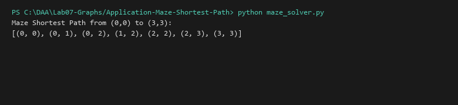

# Maze Solver and Shortest Path Navigator (Grid as Graph)

**Language:** Python 3.10+  
**Run:** `python Lab07-Graphs/Application-Maze-Shortest-Path/maze_solver.py`

## 1. Problem statement
Navigate an unweighted 2D grid maze with obstacles ($0 = \text{traversable}, 1 = \text{wall}$), computing the strictly shortest path from a start coordinate to a goal coordinate using Breadth-First Search.

## 2. Approach
The 2D grid is modeled implicitly as an unweighted graph where adjacent open cells $(r \pm 1, c)$ and $(r, c \pm 1)$ share edges. A BFS queue explores concentric frontiers, storing parent coordinates to reconstruct the optimal shortest trajectory upon reaching the target cell.

## 3. Complexity analysis
| Metric | Value |
|---|---:|
| Time Complexity | O(R \times C) |
| Auxiliary Space | O(R \times C) |

## 4. Sample I/O
```text
Maze Shortest Path from (0,0) to (3,3):
[(0, 0), (0, 1), (0, 2), (1, 2), (2, 2), (2, 3), (3, 3)]
```

## 5. Real-life application
Autonomous mobile robot warehouse navigation (AGVs in Amazon fulfillment centers), video game AI pathfinding, and PCB wire routing.


## Visual Execution Output

