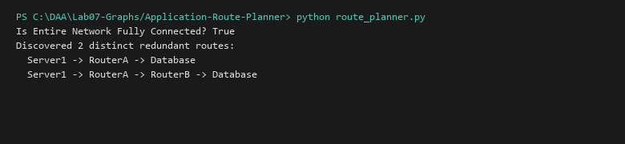

# Route Planner and Network Connectivity Analyzer

**Language:** Python 3.10+  
**Run:** `python Lab07-Graphs/Application-Route-Planner/route_planner.py`

## 1. Problem statement
Model a telecommunications routing infrastructure or computer network topology to test global reachability/connectivity and discover all simple redundant failover communication routes between endpoints.

## 2. Approach
Connectivity is tested via BFS spanning set verification. All alternate routing options are enumerated using a backtracking Depth-First Search maintaining path history to avoid cycles.

## 3. Complexity analysis
| Operation | Time | Auxiliary Space |
|---|---:|---:|
| Is Connected | O(V + E) | O(V) |
| Find All Simple Routes | O(V!) worst-case complete graph | O(V) path stack |

## 4. Sample I/O
```text
Is Entire Network Fully Connected? True
Discovered 2 distinct redundant routes:
  Server1 -> RouterA -> Database
  Server1 -> RouterA -> RouterB -> Database
```

## 5. Real-life application
BGP multi-homed ISP routing failover, microservice service mesh path discovery (Istio, Envoy), power grid resilience analysis.


## Visual Execution Output

