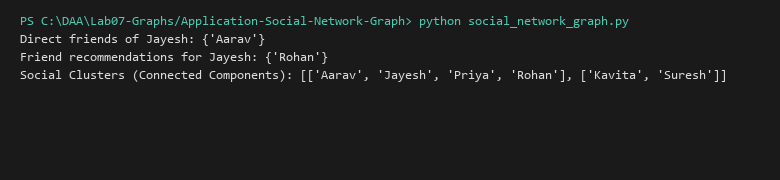

# Social Network / Friendship Graph

**Language:** Python 3.10+  
**Run:** `python Lab07-Graphs/Application-Social-Network-Graph/social_network_graph.py`

## 1. Problem statement
Model a social networking community as an undirected graph, implementing friend recommendations via friends-of-friends traversal (2-hop distance) and identifying isolated sub-communities through connected components analysis.

## 2. Approach
Vertices represent users, edges represent friendships. A 2-hop neighbor expansion identifies potential connections excluding existing direct friendships and the user. BFS traversal segments the graph into disjoint connected components.

## 3. Complexity analysis
| Operation | Time | Auxiliary Space |
|---|---:|---:|
| Friends of Friends | O(deg(u) \times \overline{deg}) | O(V) |
| Connected Components | O(V + E) | O(V) |

## 4. Sample I/O
```text
Direct friends of Jayesh: {'Aarav'}
Friend recommendations for Jayesh: {'Rohan'}
Social Clusters (Connected Components): [['Aarav', 'Jayesh', 'Priya', 'Rohan'], ['Kavita', 'Suresh']]
```

## 5. Real-life application
Facebook/LinkedIn "People You May Know" recommendation engines, fraud detection community ring identification.


## Visual Execution Output

