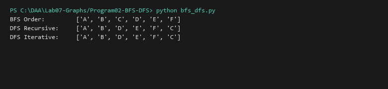

# BFS and DFS Traversals (Recursive and Iterative)

**Language:** Python 3.10+  
**Run:** `python Lab07-Graphs/Program02-BFS-DFS/bfs_dfs.py`

## 1. Problem statement
Implement Breadth-First Search (BFS) using a queue and Depth-First Search (DFS) using both recursion and an explicit stack across general directed/undirected graphs.

## 2. Approach
- **BFS:** Explores level by level utilizing a FIFO queue, guaranteeing shortest path in unweighted graphs.
- **DFS:** Follows branches as deep as possible before backtracking. Implemented recursively and iteratively via an explicit LIFO stack.

## 3. Complexity analysis
| Algorithm | Time Complexity | Auxiliary Space |
|---|---:|---:|
| BFS | O(V + E) | O(V) |
| DFS (Rec) | O(V + E) | O(V) call stack |
| DFS (Iter) | O(V + E) | O(V) explicit stack |

## 4. Sample I/O
```text
BFS Order:         ['A', 'B', 'C', 'D', 'E', 'F']
DFS Recursive:     ['A', 'B', 'D', 'E', 'F', 'C']
DFS Iterative:     ['A', 'B', 'D', 'E', 'F', 'C']
```

## 5. Real-life application
Web crawler URL exploration (BFS), social network distance calculation (BFS), maze path exploration and cycle detection (DFS).


## Visual Execution Output

